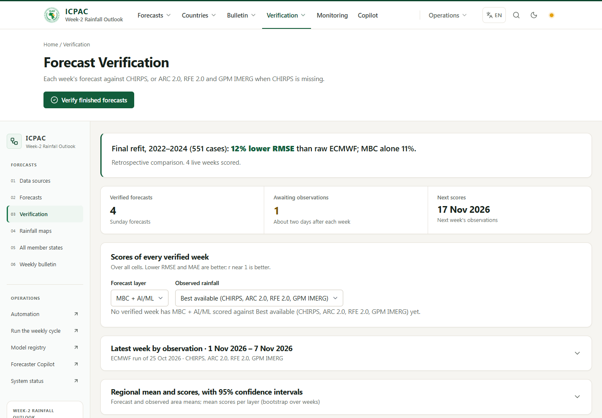

# ICPAC website review, 9 November 2026

The live Azure API reported source `52c2812c4fcdd70fbc721199966a79fd140212c7`.
GitHub main initially was `6e3d140`; the pending branch was `058a5f6`. The review started
from main and validated the pending source alongside the new fixes. While validation ran,
main advanced to `108d6c3`, including those changes and a NetCDF repair. This update was
reconciled onto that new main; its existing I/O module is retained, with in-memory
snapshot support and subprocess concurrency coverage added. A local recovery stash is kept.
The latest successful GitHub Production deployment record for Vercel names `108d6c3`
(9 November, 11:15 UTC); the public alias does not expose an independently verifiable
frontend source SHA. The additional fixes in this review are local until released.

## Findings and repairs

* The live weekly verification table contained ten ARC 2.0-scored weeks, while error
  maps, seasonal scores and automation readiness counted only CHIRPS. These views now
  use the same observation priority: CHIRPS, ARC 2.0, RFE 2.0, then GPM IMERG. Seasonal
  pooling reads the chosen observation's statistics and names the observation products.
  A replaced forecast version is excluded from its model's scored archive.
* CHC moved the v2 directory. Final, preliminary daily and preliminary dekadal requests
  now use `products/CHIRPS/v2.0/`. Direct directory checks returned HTTP 200: final daily
  files through 30 September, preliminary daily files through 5 November, and the final
  October preliminary dekad. This changes the address, not the scientific data version.
* The NOAA ERDDAP fallback verifies the returned day, number of time steps, grid and
  rainfall units. Its metadata currently ends on 30 June 2026, so it cannot fill recent
  weeks. An ERDDAP nearest-date response must never be mistaken for the requested day.
  Its downloads use the existing retry and host cooldown controls.
* New reference comparisons keep the exact scored rainfall grid, with a SHA256, locally
  and in configured Blob Storage. Maps can recover that grid after a replica restart.
  Legacy comparisons continue to depend on their daily cache or provider availability.
* Forecast provenance now carries frozen training periods. Newly rendered bulletin
  descriptions use the forecast package's own checksummed model snapshot, fixing the
  incorrect pre-refit/2005–2019 description of the 2005–2021 final refit. Package files
  and already-frozen bulletin documents are not rewritten.
* Bulletin method labels distinguish MBC from hybrid. Correction figures and ensemble
  agreement appear on the weekly page and in exports. Agreement shares exclude missing
  member counts, use latitude weights, and are labelled uncalibrated. A correction from
  zero raw rainfall is expressed in mm rather than an undefined percentage.
  Bulletin titles retain the supplied template's boundary-date convention: the end is
  an exclusive 00:00 UTC boundary. Calendar-day summaries end on the preceding day.
  The accumulated interval remains seven days (hours 168–336), not eight daily totals.
* Draft translation runs independently of forecast operations, with section progress,
  one active translation per API process, duplicate-request reuse, and worker draining
  before database shutdown. The browser recovers a job after reload and keeps following
  it across temporary network failures. A stopped process requires a translation retry;
  this is not an automatically resumable distributed translation queue.
* The verification page refreshes dependent tables/charts after a verification task,
  shows consistent pending counts and exposes seasonal-load failures. Late HTTP results
  from an earlier selection cannot replace the current selection's data.
* Operation progress polling reconnects after a temporary API failure without creating
  another task. A stale response cannot switch tracking to an older task. This fixes a
  browser-observed case where the server completed but the page stayed busy forever.
  Stable request identities now also survive a lost POST response and reload. Concurrent
  submissions use a database unique claim; a completed operation is reused. Independent
  action controls recover their saved task and late responses cannot replace it.
  A lightweight capability check prevents the new frontend from submitting/replaying
  operations to an older Azure API without request identity support. Existing operations
  can still be followed. During a staggered rollout, task submission asks visitors to
  wait for the matching backend update instead of risking duplicate work.
* The latest pending branch CI (`42587706479`) crashed in a NetCDF metadata read during
  the browser suite. Four concurrent readers reproduced a segmentation fault locally.
  A shared reentrant lock now covers native opening, lazy reads, closing and eager writes
  throughout the runtime. Isolated subprocess stress tests and a source guard cover this.
  The untrusted upload reader remains a separate process. Forecast values/encoding and
  frozen model artifacts are unchanged. NetCDF-C's own documentation says it is not
  thread safe; its array-read lock alone did not protect the opening metadata sequence.
* Cached observations no longer hide a failed monitoring provider check in `/health`.
  The warning retains the cached period so availability is not confused with freshness.
* A shadcn/ui dashboard adaptation links working pages in an inset rail, with an
  internally scrolling strip on smaller screens. Historical country links and Copilot's
  bulletin link keep the selected forecast week. See [design decisions](ui-workspace.md).
* A self-contained [Kaggle Copilot notebook](../training/copilot/README.md) covers all
  eleven current answer languages. It freezes the actual prompts/tool schemas, validates
  reviewed grouped data, masks loss to assistant targets, compares a base model with its
  adapter and requires per-language mechanical and native-speaker review gates. Actual
  pinned-tokenizer masking/tool-call roundtrips passed for all eleven languages. No GPU
  training, language-accuracy result or inference deployment is claimed.
* Integrated pending menu translations cover English, Kiswahili, French, Arabic, Amharic
  and Somali, with responsive menus. Untranslated scientific content stays in English;
  fluent speakers must review the machine-written translations before operational use.

## Release boundaries

Public evaluation access remains as requested. Model parameters, training artifacts,
approval roles, the live scheduler and cloud credentials are unchanged. No live forecast,
bulletin approval, publication or email was triggered during this review.
The live scheduler is **weekly**, with finished-week verification every three hours.
There is no newly enabled daily forecast schedule. Local QA disables the scheduler and
uses local provider fixtures, a mock language model and a file email outbox.

An Azure 403/429 can persist after an address change if its outbound IP is restricted.
The connector keeps its cooldown; ICPAC may need CHC to allow that IP. The live Copilot
also reported an AI-service timeout. Code changes do not establish the capacity or
latency of that external model endpoint.

HPC activation, optional acquisition profiles, reviewed climatology/temperature/heat
stress inputs and accountable production access remain separate operational inputs.
Menu translations do not imply that the entire website or every bulletin is translated.
Word content/structure checks do not establish page-by-page visual pagination.

## All 20 capabilities: observable acceptance

`Local` means code/regression evidence; `live` means a read-only observation of the
deployed service, not proof that the unshipped fixes are active. A website capability
label alone is not an acceptance test.

| # | Capability and acceptance criterion | Evidence now | Remaining boundary/input |
| --- | --- | --- | --- |
| 1 | Acquisition: a complete ensemble/required upper-air run passes QC, caches validated bytes and records source/date/checksum; interrupted/throttled retrieval is bounded. | Local mirror/cache/tamper/retry tests; live ECMWF run 8 November and upper-air inputs held. | Optional IFS/AIFS profiles need an approved regional variable/units request and pinned profile checksum; S2S needs approved MARS access. Acquired optional feeds cannot replace training inputs automatically. |
| 2 | Observations: source-specific daily/dekadal files have exact dates, units, coordinates and provenance; missing days prevent a complete week. | Local CHIRPS/ARC2/RFE2/IMERG/TAMSAT tests; live October monitoring and reference comparisons. Current CHC v2 directories verified by HTTP. | Deploy the path fix. CHC may need to allow Azure's outbound IP after 403/429. The NOAA mirror's June coverage cannot replace current data. ERA5 needs approved CDS access/profile. |
| 3 | QC: missing steps, invalid units, nonfinite cells, corrupted cache or incompatible grids fail before scientific inference. | Local input, native reader, cache and contract regressions; live run records contain checks. | Provider availability is external; passing fixture tests does not certify every future input. |
| 4 | Preprocessing: frozen transformations and feature ordering are reused with provenance; incompatible real-time input remains gated. | Local frozen-bundle/refit tests and checksums; live candidate uses its recorded compatibility decision. | A new final model requires its exact preprocessing, schema and input compatibility evidence. |
| 5 | Week-2: hours 168–336 give the correct seven-day valid period and rainfall total in mm. | Local accumulation/unit/window tests; live package periods distinguish current and upcoming weeks. | No substitution of a daily rate or a partial seven-day window. |
| 6 | Harmonization: authoritative 0.05° mask/cell ordering and country IDs are preserved. | Local domain rejection/order tests; live eleven-country packages. | A changed domain requires a reviewed versioned artifact. |
| 7 | Predictors: only the selected model's frozen required columns/PCs are built and checked. | Local feature-order and refit-bundle tests; existing final-refit candidate has 24 inputs. | The proposed 245-variable set has not been supplied; it is not invented or marked implemented. |
| 8 | Bias correction: frozen monthly MBC factors are used, without fitting on live/test data. | Local frozen-statistics tests/checksums; live separate raw and MBC layers. | Different correction statistics require approved artifacts and validation. |
| 9 | ML inference: a registered artifact runs only with its required inputs and review; absent hybrid is visibly unavailable. | Local candidate/activation/refit tests; live hybrid produced by the recorded candidate. | This is an evaluation candidate. Final model promotion needs its frozen artifacts, accountable scientific approval and independent evidence where claimed. |
| 10 | Comparison: raw, MBC and hybrid retain distinct arrays, labels, periods and metrics. | Local layers/export tests and browser checks; live separate layer views. | Missing products are not compared as if they existed. |
| 11 | Verification: only complete same-period observations score the forecast of record; provenance/units and protected-period labels agree. | Local fallback/replacement tests. Live weekly table has ARC2 scores that older readiness views miss; repaired locally. | Deploy and recheck live consistency; missing observation days remain pending. Historical independent tests and final-refit retrospectives stay separate. |
| 12 | Spatial verification: per-cell errors/skill use exact paired fields; correlation requires at least three valid cases and missing cells stay masked. | Local fallback-grid restoration/checksum/correlation tests; browser creates past cases and renders correlation maps. | Old comparisons without frozen snapshots can still depend on provider/cache recovery. Deploy to repair live CHIRPS-only counts/maps. |
| 13 | Extremes: weekly rainfall categories/member agreement are explicit and uncalibrated; climatological extremes require reviewed thresholds. | Local weighted ensemble/correction tests and bulletin/map browser checks. | Reviewed climatology and extreme-percentile thresholds are missing. Heavy-rain categories are not calibrated hazard probabilities. |
| 14 | Countries: eleven summaries and maps use the same forecast package, country mask and area weighting; navigation preserves the week. | Local country/provenance tests; live eleven summaries; new browser context checks. | No fabricated country anomaly/tercile categories. |
| 15 | Maps: labelled units, valid period, method and authoritative domain agree with the package, including unavailable-layer states. | Local map/package/content checks; browser image and responsive checks. | Colour/legend/domain changes require scientific review; screenshots are QA fixture data. |
| 16 | Bulletin: frozen draft/Word contents, figures and method labels agree with source package; editing/translation makes reviewed versions. | Local Word structure/content, method/refit and translation-bound tests; browser draft/edit/review workflow. | Reviewed anomaly/temperature/heat-stress inputs and native language review are missing. Word pagination still needs visual review in Word/LibreOffice. |
| 17 | Updates: scheduled work is idempotent, observable and cannot silently enable daily forecast execution. | Local scheduler/operation identity tests; live weekly scheduler enabled with three-hour verification. | **Daily forecast scheduling deliberately remains disabled** as requested. This original daily automation is not claimed complete/active. |
| 18 | Archive: immutable forecast/model/input identity and checksum-pinned products survive retries/restarts. | Local package/Blob restoration and replacement tests; live archive held. | Legacy unfrozen observation comparisons may need cache restoration; backup/restore operations require the actual storage account/runbook. |
| 19 | Monitoring: operation recovery, retry/stop/error states and HPC status are observable, without duplicate submissions. | Native crash reproduced/repaired; full local browser operations run; unit recovery/concurrency tests. Live task history readable. | HPC activation needs the approved host/account/partition, pinned SLURM script/profile, shared data paths, connectivity and return-artifact contract. No real HPC submission was made. |
| 20 | Dissemination: draft → review → approval → publication is explicit; no automatic approval or publication. | Local API/content guards; browser review and file-outbox email links; live configuration/history inspected read-only. | Public evaluation uses typed names, not accountable staff identities. Production staff access and approved recipients/distribution are intentionally deferred. |

## Validation and release gate

* Before the main refresh, the full Linux backend suite passed **387 tests**, with two optional LightGBM/XGBoost
  runtime cases and one dedicated-PostgreSQL coordination case skipped. Two upstream
  Zarr v3 metadata warnings remain. No test failure is hidden by those skips.
* A later focused backend run passed **12 tests** covering monitoring warnings,
  translation reuse and the notebook. The updated request-identity/capability regression
  also passed independently. These follow-ups are not presented as another full-suite run.
  After refreshing main and consolidating I/O, **78 affected backend regressions passed**
  in 411.90 seconds: native concurrency, inputs/references, refit compatibility,
  bulletins/translation, monitoring, operation identity and the training contract.
* Backend Ruff lint/format checks passed; post-reconciliation mypy passed for **136 source files**. Frontend
  lint, complete TypeScript checks, **38 unit tests**, Prettier and the Node 22 Linux
  production build passed. No GPU fine-tuning or native-speaker language evaluation ran.
* Initial Windows standalone packaging failed on symlink permissions. The Node 22 Linux
  standalone build is the release proof; local Windows packaging is not claimed passed.
* Existing main CI `42413281232`, container build `42413281187` and backend image publish
  `42413950608` passed for `6e3d140`. The new local source needs its own GitHub CI/image
  checks after an authorized push; old green checks do not validate a future commit.
  Refreshed main `108d6c3` also passed CI `42607492265`, container build `42607492324`
  and image publish `42609100995`. These validate upstream, not the unpushed update.
* The established browser workflow run passed **32 checks**, with one public-only case
  skipped in staff-mode QA. A focused public-mode run passed **five checks** covering
  setup, public history isolation, responsive views, historical links and translation
  recovery across failed polling and reload. A final strengthened visual check passed
  separately: six working pages at 320, 375, 768 and 1440 pixels, plus Arabic/dark mode,
  loaded map images and zero page JavaScript exceptions. The strengthened image wait
  initially used a five-second assertion during API warmup; a bounded sixty-second
  wait now matches the service's documented cold-start allowance.
  **After the main refresh, all 19 selected public browser journeys passed** on a fresh
  QA database (5.8 minutes), including acquisition and verification of four past weeks,
  correlation/reliability maps, country context, public Copilot history and translation
  polling/reload recovery. The test's initial forecast-list fetch also waits for a valid
  response across temporary 503s. Reusing an already populated QA archive does not
  satisfy the past-weeks test's explicit zero-case starting condition.
* Manual browser review confirmed the desktop workspace, mobile bulletin/Copilot
  controls and Kenya map selection. The screenshots below contain isolated QA fixtures,
  **not operational rainfall**. There is no approved pixel baseline, so visual regression
  against an approved design remains **INCONCLUSIVE**. This is not a full WCAG or field
  Core Web Vitals certification. Native Word pagination still requires visual review.
* No Azure deployment or live scheduler change was made by these tests. Release the
  matching backend before expecting the new frontend's operation submissions to work.

[Desktop verification](screenshots/review-2026-11-09-verification.png) ·
[Arabic / dark mode](screenshots/review-2026-11-09-arabic-dark.png) ·
[Mobile Copilot](screenshots/review-2026-11-09-copilot-mobile.png)

## Source checks

* [CHC's versioned CHIRPS directory](https://data.chc.ucsb.edu/products/CHIRPS/)
* [CHIRPS v2 preliminary daily files](https://data.chc.ucsb.edu/products/CHIRPS/v2.0/prelim/global_daily/tifs/p05/2026/)
* [CHIRPS v2 preliminary dekads](https://data.chc.ucsb.edu/products/CHIRPS/v2.0/prelim/global_dekad/netcdf/)
* [NOAA mirror metadata, including coverage and units](https://coastwatch.pfeg.noaa.gov/erddap/info/chirps20GlobalDailyP05/index.html)
* [NetCDF-C thread-safety FAQ](https://docs.unidata.ucar.edu/netcdf-c/current/faq.html)
